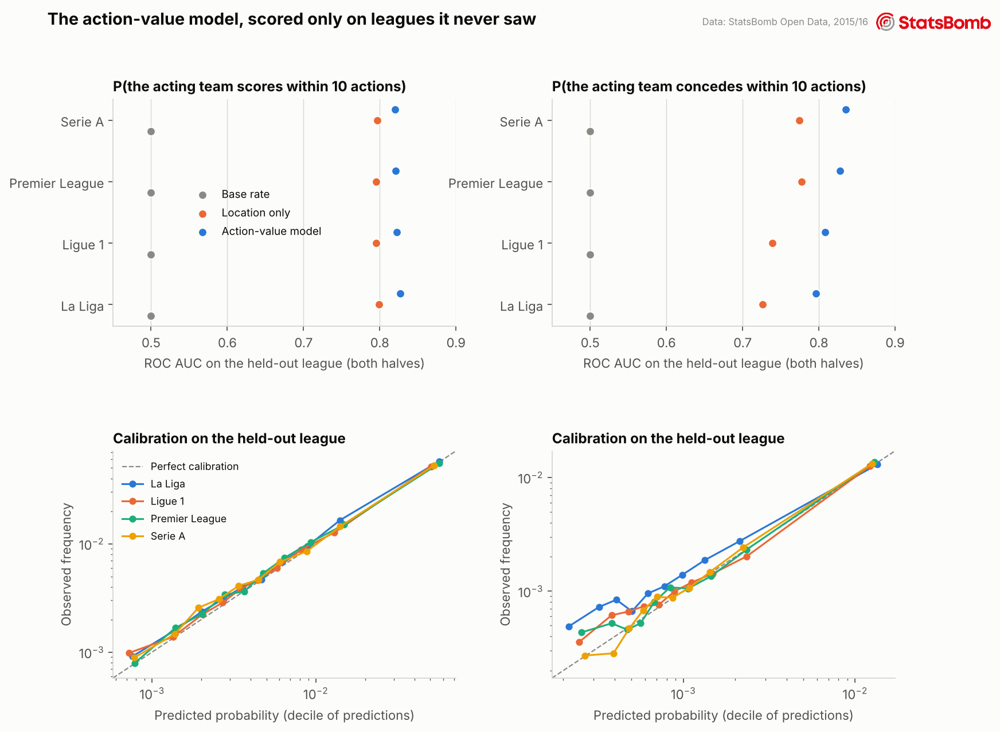
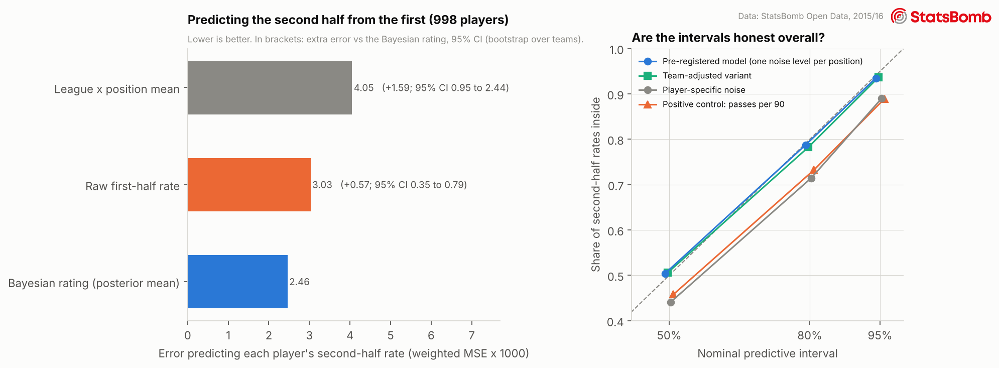
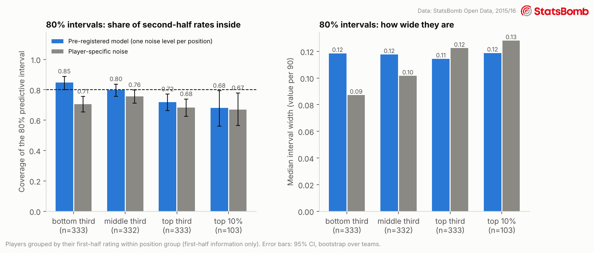
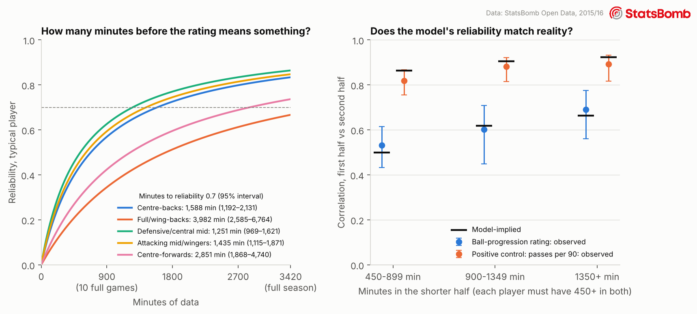
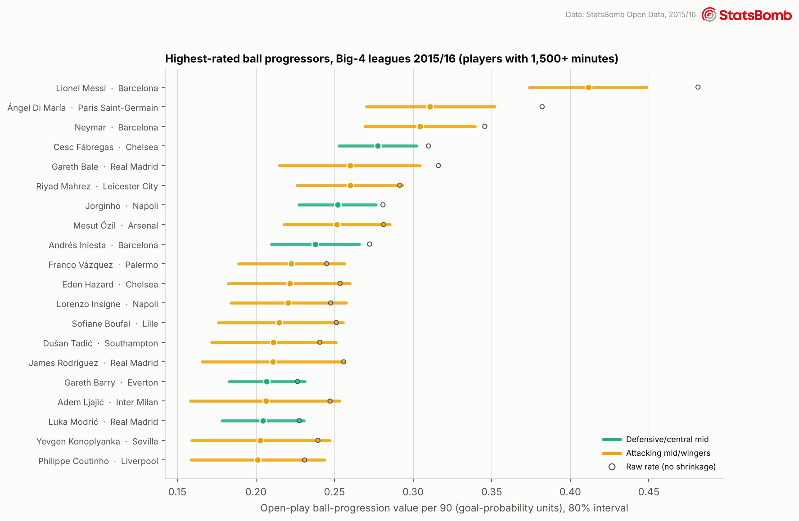
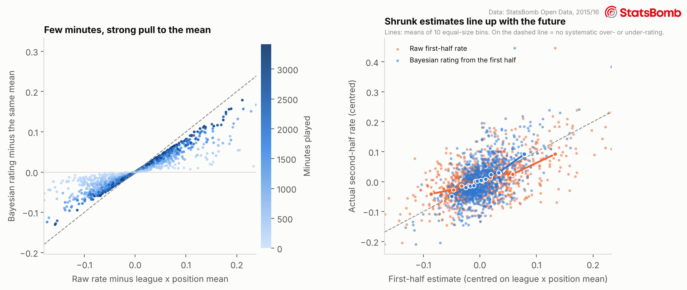

# Ball-progression ratings with honest uncertainty

**Who moves the ball forward in Europe's big leagues, how sure can we be, and how many minutes of football does it
take to know?** Bayesian ratings of open-play ball progression for every outfield player in the 2015/16 Premier
League, La Liga, Serie A and Ligue 1, built on StatsBomb event data and validated forward in time: fitted on the first
half of the season, scored on the second.

<p><br><sub>Data: StatsBomb Open Data</sub></p>

**[Open the interactive explorer](https://ridhimagupta4.github.io/progression-ratings/)**: pick a league and
position, see the top 20 with their intervals, follow any player's rating as it firms up over the season, and drag a
slider to see how reliability grows with minutes.

---

## Key results

| | |
|---|---|
| **Action-value model, scored only on leagues it never saw** | ROC AUC 0.820–0.827 for "team scores within 10 actions" (location-only model: 0.796–0.799) and 0.797–0.835 for "team concedes". Log loss 21.6–22.3% below the base rate for scoring and 13.8–17.9% for conceding. |
| **Forward test, 998 players** (450+ minutes in both halves) | First-half Bayesian ratings predicted second-half rates with **19% lower error than raw first-half rates** (weighted MSE 0.00246 vs 0.00303; difference 95% CI 0.00035 to 0.00079, bootstrap over teams) and 39% lower than the league-position average (0.00405). |
| **Intervals, overall** | 50 / 80 / 95% predictive intervals contained 50.4 / 78.8 / 93.5% of second-half rates (80%: 95% CI 75.6 to 81.7%). |
| **Intervals, for the best players** | **Too narrow.** 80% intervals contained 84.7% of second-half rates for the bottom third of players, 79.8% for the middle third, **71.8% for the top third and 68.0% for the top 10%** (95% CIs 66.4 to 77.1% and 55.9 to 79.4%). A fix was tried under a decision rule written down before its results were seen; it did worse and was rejected. |
| **Minutes needed for a reliability of 0.7** (typical player) | Defensive/central midfielders 1,251 · attacking midfielders/wingers 1,435 · centre-backs 1,588 · centre-forwards 2,851 · full-backs/wing-backs 3,982 (more than a full season). These are uncertain: 95% intervals run from 969–1,621 (central midfielders) to 2,585–6,764 (full-backs). |
| **Does the model know its own reliability?** | Model-implied vs observed first-half/second-half correlation: 0.50 vs 0.53, 0.62 vs 0.60 and 0.66 vs 0.69 in three minutes bands; every model value is inside the observed value's 95% CI. |
| **Positive control** (attempted open-play passes and crosses per 90, a known stable trait) | Reliability 0.7 after 199–392 minutes; observed half-to-half correlation 0.82–0.89. The pipeline finds stability where it exists. |
| **Team context** | A model with a shared team effect ranks players almost identically (Spearman 0.978), but team context cannot be fully separated from player skill within one season, so the ratings describe value added in the player's actual team. |

Top of the full-season table (players with 1,500+ minutes): Lionel Messi 0.411 per 90 (80% interval 0.374 to 0.448),
Ángel Di María 0.311, Neymar 0.304, Cesc Fàbregas 0.277, Gareth Bale 0.260, Riyad Mahrez 0.260.

---

## Why this question

Per-90 leaderboards built on a few hundred minutes are mostly noise, and a scout or analyst usually has exactly that:
a loan spell, half a season, a player returning from injury. The useful questions are not just "who is best" but
"how sure are we" and "how much more do we need to watch". This project answers all three for one well-defined skill,
open-play ball progression, and checks every claim about uncertainty against what actually happened next.

## Data

- [StatsBomb Open Data](https://github.com/statsbomb/open-data), pinned to commit
  `4b73468fc5b0f1950f9f66fada70ad3a4f9327cb`. Every one of the 3,040 files used is checked against its git blob hash
  (`data_manifest.tsv`).
- 2015/16 Premier League (380 matches), La Liga (380), Serie A (380) and Ligue 1 (377; three matches are not in the
  release): 1,517 matches, 3.23 million on-ball actions, 2,176 players (1,988 outfield players rated).
- Excluded: the 2015/16 Bundesliga, which in the public release contains only Bayer Leverkusen's matches.
- Season split per league by date: matches before the first round-20 fixture form the first half (H1), the rest the
  second half (H2).

## Method

**1. Value every action.** An action-value model in the style of VAEP (Decroos et al., 2019) estimates, for each
action, the probability that the acting team scores, and separately concedes, within the next 10 actions. An action's
value is the change in (P score − P concede) that it causes. Features use only the current action and the two before
it. Gradient-boosted trees with hyperparameters fixed in advance; this is an independent implementation, not the
`socceraction` package.

**2. Build the measure.** A player's open-play ball-progression value is the sum of the values of his open-play
passes, crosses, carries and dribbles. Minutes come from the event stream (starting XI, substitutions, red cards).

**3. Rate players with partial pooling.**

```
value of player p in match m  ~  Normal(lambda_p * t_pm,  sigma_g^2 * t_pm)      t_pm = minutes / 90
lambda_p                      ~  Normal(mu[league, position group],  tau_g)
```

The variance grows with time on the pitch, as for a sum of many small contributions. `tau_g` is the real spread of
skill within a position group and `sigma_g` the match-to-match noise, so the reliability of a rate after `m` minutes
is `tau^2 / (tau^2 + sigma^2 / (m/90))`. Fitted with NUTS in NumPyro (4 chains × 1,000 draws after 1,000
warm-up); R-hat ≤ 1.010 and no divergent transitions for every model reported here, except one sensitivity analysis flagged below.

**4. Validate forward in time.** Fit on H1 only, predict each player's H2 rate, and score the point predictions, the
predictive intervals and the implied reliability against what happened.

### Leakage controls

| Risk | Control | Checked by |
|---|---|---|
| Action values learned from the matches they score | The model that values league L is trained only on the other three leagues | Assertion in `vaep.py`; test |
| Future information in action values | Training data are the first halves only, so no H2 match of any league is ever seen by the value model | Test |
| Features or labels that look ahead | Features use the current and two previous actions; labels stop at the end of the period; goal difference excludes the current goal | Unit tests on constructed sequences |
| H2 data entering the rating fit | Validation fits receive H1 rows only; priors are scaled with H1 data only | Test that intercepts the data passed to the fit |
| Choosing a model by its validation score | Design written down first (`DESIGN.md`); the one model change made later had its acceptance rule fixed before its validation was run | `DESIGN.md`, `results/model_choice.csv` |
| Data errors inflating or deflating minutes | Minutes rebuilt from events after line-up errors were found | Test: no team ever has more than 11 players on the pitch |
| Goals credited to the wrong team | Teams resolved by id, not name | Test: per-team goals equal the official score in all 1,517 matches |

## Results

### 1. The action-value model transfers across leagues



Each league is scored by a model that never saw it. The full model beats a location-only model in every league, by
more for conceding (AUC +0.05 to +0.07) than for scoring (+0.02 to +0.03), and its probabilities are calibrated
across the whole range: in the top decile of predictions, predicted and observed scoring rates differ by at most 0.002.

### 2. Shrinkage beats raw per-90 numbers, and the intervals are honest on average



Raw first-half rates are too extreme: players who looked best fell back, on average, by 0.023 per 90 in the second
half. Partial pooling corrects this, with 19% lower error than raw rates and no systematic over- or under-rating by
level (right panel of figure 6). Predictive intervals are well calibrated overall. The same is true for players who
stayed at one club all season (927 players: 80% coverage 78.5%).

### 3. ...but not for the best players



A check on first-half data alone showed that match-to-match noise grows with a player's level: the median noise in
the top third of rates is 1.3 to 1.9 times that of the bottom third, in every position group. With one noise level
per position, intervals end up too wide for low-rated players and too narrow for high-rated ones, while the average
looks right. That is exactly what the second half showed: 80% intervals caught only 71.8% of the top third (95% CI
66.4 to 77.1%, bootstrap over teams) and 68.0% of the top 10% (55.9 to 79.4%; only 103 players, so this estimate is
imprecise), while the bottom third got 84.7% (80.1 to 88.8%). The point predictions for those players were fine; on average the top 10% did slightly better than
predicted (+0.016 per 90). The errors were simply more spread out (standard deviation 0.061 in the top third against
0.043 in the bottom third).

The natural fix, a noise level per player partially pooled towards the position's, was fitted and validated under a
rule fixed before its results were seen: adopt it only if its overall 80% coverage was within 3 points of 80% and it
improved the top third. It failed both (overall 71.4%, top third 68.2%) and also predicted worse (MSE 0.00296, no
better than raw rates). The published ratings therefore use the pre-registered model, and **an 80% interval for a
top-rated player should be read as roughly a two-in-three interval**. Its "chance of being top 10%" is overconfident
in the same way. A noise model tied to the player's rate, chosen on an inner split of the first half, is the next
step; it was not tried here because trying models one after another against the second half would turn the test
set into a tuning set.

### 4. How many minutes before a rating means something



Central midfielders and attacking players separate from each other quickly, because they get on the ball often and
the spread of skill between them is large. Full-backs are the hardest: their progression is noisy and they differ
little from each other, so even a full season gives a reliability of about 0.66. These minute counts carry real
uncertainty, because the skill spread `tau` is estimated from one half-season: the 95% posterior interval for
full-backs is 2,585 to 6,764 minutes and for centre-forwards 1,868 to 4,740 (all intervals are in the figure and in
`results/reliability.csv`). The reliability the model claims
agrees with the half-to-half correlation actually observed (right). The positive control, passes per 90, is reliable
after two to four full matches, as a volume-and-style measure should be.

### 5. The ratings





Low-minute players are pulled strongly towards their league-position average (left); players with a full season keep
most of their raw rate. Right: first-half estimates against what happened next. The binned raw rates (orange) lie on
a flatter line than the binned Bayesian ratings (blue), which sit close to the diagonal.

## What this does not show

- **Team context is inside the number.** A player in a dominant side receives the ball in better situations. A
  variant with a team effect ranks players almost identically (Spearman 0.978 on the 998 validation players) and
  reduces the skill spread most for centre-backs (tau 0.026 to 0.017), but within one season player and team effects
  cannot be separated cleanly: 927 of the 998 validation players never changed club.
- **One skill, one season.** Open-play progression only: no shooting, set pieces, defending or off-ball movement. The
  data are from 2015/16; the method transfers, the specific numbers do not.
- **Intervals for top players are too narrow** (section 3), and their top-10% probabilities are overconfident.
- **The validation sample is players with 450+ minutes in both halves**, so the forward test says nothing directly
  about players with fewer minutes, the group where shrinkage matters most.
- **The full-season ratings have no out-of-sample check of their own.** What was validated is the procedure.
- **The season paths in the explorer** use the full-season model settings at every date. They show how a rating
  firms up; they are not what an analyst would have known at the time.
- **Positive-control intervals are also too narrow** (73.2% at 80%, 95% CI 69.4 to 76.8%), with the same top-third
  pattern (64.0%). The
  control's purpose, detecting a stable trait, is met; its intervals carry the same caveat.
- **The player-specific-noise model for passes** has R-hat 1.018 (above the usual 1.01). It is a sensitivity analysis
  that was not used for any published number.
- **Action values are in goal-probability units over a 10-action horizon.** They measure contribution to the next few
  actions, not to the result, and depend on modelling choices fixed in advance rather than tuned.
- **Data details.** Minutes treat temporary treatment absences as time on the pitch. Positions come from each
  player's most frequent position in a match. Seven of the 3.23 million actions fall slightly outside the acting
  player's recorded time on the pitch (substitutions logged late in two matches); the effect on minutes is
  negligible.

## Reproduce

Requires Python 3.13, about 5 GB of disk and 8 GB of RAM. Total runtime about 1.5 hours on two CPU cores.

```bash
pip install -r requirements.txt
./fetch_data.sh          # downloads the pinned StatsBomb files and verifies every hash (~4.3 GB)
./run_all.sh             # actions -> action values -> ratings -> figures -> page -> tests
```

Seeds are fixed in the code; a re-run reproduces the numbers up to small Monte Carlo and floating-point differences
between platforms.
The derived data in `data/` are not committed, because they contain event-level data.

## Repository layout

```
DESIGN.md                 study design written before fitting, with every later deviation and its reason
src/actions.py            events -> actions, minutes (from events), matches, player names
src/vaep.py               action-value model, leave-one-league-out, first halves only
src/ratings.py            Bayesian rating model; first-half -> second-half validation; decision rule
src/publish_ratings.py    full-season ratings, reliability, top-10% probabilities, season paths
src/figures.py            all figures
src/verify_data.py        hash check of the downloaded files against data_manifest.tsv
explorer/                 interactive page: export of aggregated results, template, build script
docs/index.html           the built page (served by GitHub Pages)
results/                  all tables behind the numbers in this README, plus run logs
tests/                    leakage, data-integrity and README-number tests
```

## Licence and credit

- Code: MIT licence (`LICENSE`).
- Data: StatsBomb Open Data, used under the StatsBomb Public Data User Agreement. No StatsBomb data are included in
  this repository. The results, figures and interactive page are derived analysis shared for non-commercial use and
  are not covered by the MIT licence. StatsBomb logo shown as the data credit. See `THIRD_PARTY_NOTICES.md`.

## References

- Decroos, T., Bransen, L., Van Haaren, J. and Davis, J. (2019). Actions speak louder than goals: valuing player
  actions in soccer. *Proceedings of KDD 2019*.
- Gelman, A., Carlin, J. B., Stern, H. S., Dunson, D. B., Vehtari, A. and Rubin, D. B. (2013). *Bayesian Data
  Analysis*, 3rd edition. Chapman and Hall/CRC.
- Phan, D., Pradhan, N. and Jankowiak, M. (2019). Composable effects for flexible and accelerated probabilistic
  programming in NumPyro. arXiv:1912.11554.
